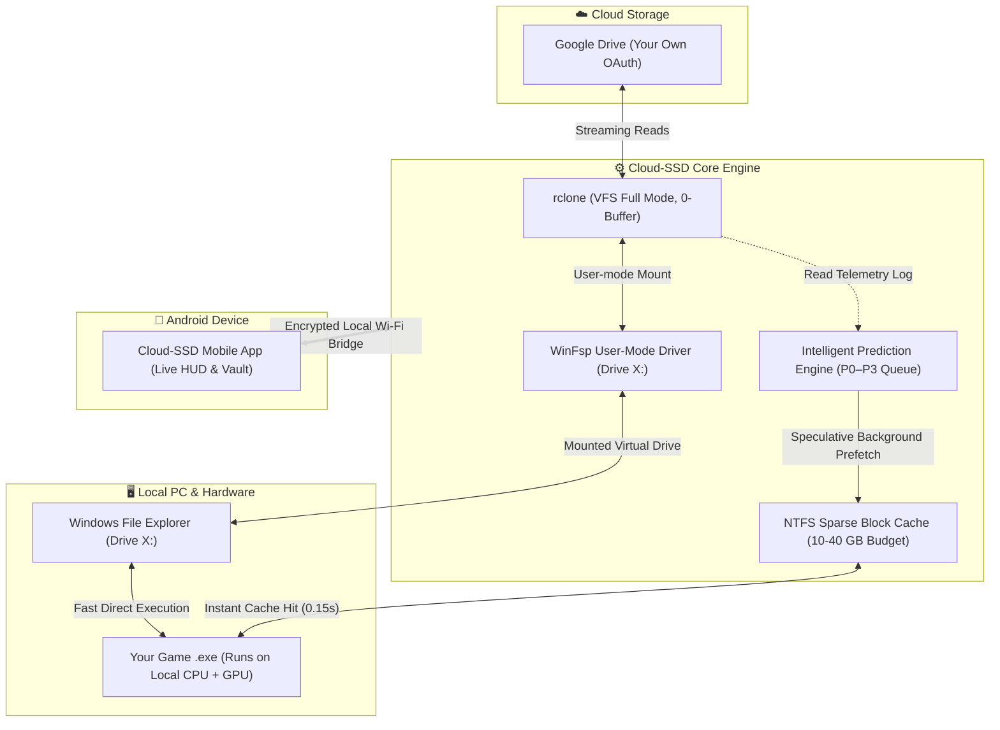

# 🚀 Cloud-Drive (Cloud-SSD)

<div align="center">

[](https://github.com/allproject121/Cloud-Drive)
[](https://github.com/allproject121/Cloud-Drive)
[](https://github.com/allproject121/Cloud-Drive)
[](https://winfsp.dev/)
[](https://github.com/allproject121/Cloud-Drive/releases)
[](LICENSE)

**Cloud-to-SSD Virtual Storage & Intelligent Predictive Game Streaming Engine for Windows.**  
*Apne PC Games ko Cloud Storage (Google Drive) mein rakho, bina space gawaye local drive letter (`X:`) se khelo, aur local SSD jaisi fast speed enjoy karo.*

[Direct Downloads](#-direct-downloads) • [How It Works](#-how-it-works-kaise-kaam-karta-hai) • [Feature Breakdown](#-interactive-feature-breakdown-har-feature-ka-pura-detail) • [Benchmarks](#-real-world-benchmarks) • [Quick Setup](#-quick-setup-guide)

---

</div>

## 📥 Direct Downloads

| Platform | Download Link | Version | File Size | Description |
|---|---|---|---|---|
| 💻 **Windows** | [**Download Windows Setup (EXE)**](releases/Cloud-SSD-0.7.0-setup.exe) | v0.7.0 | `~67.5 MB` | Complete Windows 10/11 (x64) Installer with Desktop UI & CLI |
| 📱 **Android** | [**Download Android Companion (APK)**](releases/Cloud-SSD-Mobile.apk) | v1.0.0 | `~1.1 MB` | Mobile HUD, Remote Game Launcher & Offline Saves Vault |
| 🔒 **Checksum** | [View SHA256 Checksum](releases/Cloud-SSD-0.7.0-setup.exe.sha256) | v0.7.0 | `93 B` | Cryptographic integrity verification for Windows Setup |

---

## ⚡ What is Cloud-Drive? (Yeh Kya Hai?)

**Cloud-Drive (Cloud-SSD)** koi cloud gaming service (jaise GeForce Now ya Xbox Cloud) **nahi** hai. Yahan game aapke hi PC ke CPU aur GPU par run hota hai. 

Lekin aapko 100 GB ke game ko local drive par download karke poori hard disk bharne ki zarurat nahi hoti! Yeh aapke cloud storage (Google Drive) ko Windows File Explorer mein ek **Real Virtual Drive (`X:`)** bana kar mount karta hai. Game sirf wahi files/chunks download karta hai jo us samay play karne ke liye zaroori hote hain, aur Intelligent AI Prediction Engine game start hone se pehle hi agle zaroori data ko local SSD par prefetch kar leta hai.

---

## 🔄 How It Works? (Kaise Kaam Karta Hai?)



### 1. Virtual Drive Mount (Zero Kernel Drivers)
WinFsp aur rclone ke zariye Google Drive aapke PC par ek standard drive (`X:`) ki tarah dikhta hai. Windows aur game ko lagta hai ki yeh ek normal local hard drive hai.

### 2. Block-Level Sparse Caching
Agar kisi game ki file 50 GB ki hai aur game usme se sirf 50 MB ka sound ya texture maang raha hai, toh Cloud-Drive poora 50 GB download nahi karta — yeh sirf wahi 50 MB ka block download karke NTFS sparse file mein cache karta hai.

### 3. Predictive Prefetching (AI Telemetry)
Jab aap game khelte hain, engine exact byte-level read patterns ko learn karta hai. Agli baar jab aap game kholte hain, toh game ke mangne se pehle hi required assets background mein SSD par prefetch ho jaate hain.

### 4. Zero Cloud Contention
Game ke direct read request ko **Priority P0** di jaati hai. Background prefetching (P1-P3) game ke beech mein kabhi internet bandwidth compete nahi karti.

---

## 📂 Interactive Feature Breakdown (Har Feature Ka Pura Detail)

> *Neeche diye gaye kisi bhi feature par click karein aur uska poora working mechanism dekhein:*

<details>
<summary><b>1. 🎮 Real Virtual Drive Engine (WinFsp + rclone Architecture)</b></summary>
<br>

* **Drive Letter Emulation:** Google Drive ko `X:`, `Y:`, `Z:` ya kisi bhi custom drive letter par Windows File Explorer mein expose karta hai.
* **VFS Cache Mode Full:** rclone ka sparse block-level VFS engine use karta hai jisme read, write, aur safe write-back support hota hai.
* **Zero Buffer Overhead:** Default 16 MiB rclone buffer ko 0 par lock kiya gaya hai taaki random 64 KiB reads ke liye faltu data download na ho.
* **Auto-Restart & Crash Guard:** Agar background mount process kisi wajah se crash hota hai, toh app usse bina game band kiye silently auto-restart aur re-attach kar leta hai.
* **Sleep & Resume Safe:** PC ke sleep se jagane par drive disconnected nahi hoti; automatic health probes mount ko active rakhte hain.

</details>

<details>
<summary><b>2. 🧠 Intelligent Prediction & Prefetch Engine</b></summary>
<br>

* **Per-Game SQLite Profile:** Har game ke liye exact byte offsets aur read sequence ka profile local SQLite database mein store hota hai.
* **Startup Predictor:** Game boot hone par kon-kon si DLLs, intros, shaders, aur config files load hoti hain, unhe 1 click me **"Optimize & Prepare"** ke dauran pehle hi load kar leta hai.
* **Sequential Predictor:** Audio, video aur cutscene streams ko detect karke linearly aage ke chunks pehle se pull karta hai.
* **P0–P3 Priority Scheduling:**
  * **P0 (Critical):** Game ka live read — instant direct pipe.
  * **P1 (High):** Agle 5 second me zaroori assets.
  * **P2 (Speculative):** Agle expected level ke assets.
  * **P3 (Idle):** Low priority background prefetch.

</details>

<details>
<summary><b>3. 💾 Smart Cache & Disk Safety Guard</b></summary>
<br>

* **Budget Presets:** 10 GB, 20 GB, 30 GB, 40 GB ya Custom Storage limit set karein.
* **Physical vs Logical Allocation:** Windows P/Invoke (`GetCompressedFileSizeW`) se actual physical disk usage track karta hai, logical size nahi.
* **Disk Pressure Pause:** Agar aapki main Windows C: drive par free space safe limit se kam ho jaaye, toh caching aur prefetching automatically ruk jaati hai taaki Windows crash na ho.
* **Marker-Guarded Cleanup:** Cache deletion sirf `.cloudplayx-cache` marker file wali folders par chalti hai — aapke cloud files ya save games ko kabhi chhua nahi jaata.

</details>

<details>
<summary><b>4. 🕹️ Game Library, PE Scanner & Sandboxed Launcher</b></summary>
<br>

* **Automatic Executable Detection:** Cloud folder ko select karte hi game ke main `.exe` ko automatic scan karta hai.
* **PE Header & Missing DLL Inspector:** Portable Executable (PE) headers aur import table ko read karke pehle hi bata deta hai ki VC++ Redistributable ya DirectX missing hai ya nahi.
* **Anti-Cheat & DRM Compatibility Guard:** EasyAntiCheat, BattlEye, Denuvo, aur custom game launchers ko detect karke safe recommendations deta hai.
* **Job Object Process Sandbox:** Har game ek isolated Windows Job Object mein chalta hai. Game crash hone par crash code aur NTSTATUS live monitor par dikhta hai.

</details>

<details>
<summary><b>5. 📱 Android Mobile Companion App & Remote HUD (`Cloud-SSD-Mobile.apk`)</b></summary>
<br>

* **Zero-Setup Wireless Pairing:** Desktop app ke QR code ko scan karke ya local IP enter karke bina kisi third-party cloud server ke connect karein.
* **Live PC Gaming HUD:** Apne phone par live PC specs, game FPS, cache hit-rate, aur download throughput monitor karein.
* **Remote Game Launcher:** Phone se hi virtual drive par maujood kisi bhi game ko ek tap mein PC par launch karein.
* **100% Offline Save Game Vault:** Apne game saves ka backup phone ki local internal storage mein rakhein. PC format hone par bhi game saves secure rahenge.

</details>

<details>
<summary><b>6. 📊 Real-Time Telemetry & Performance HUD</b></summary>
<br>

* **Hardware-Accelerated Sparklines:** Live throughput aur bandwidth graph rendering.
* **Cache Hit vs Miss Verdict:** rclone ke real telemetry se exact hit/miss percentage aur read wait times (latency) dikhata hai.
* **Zero Fabricated Data:** Agar telemetry available nahi hai, toh app fake data dikhane ke bajaye honestly **"Unavailable"** report karta hai.

</details>

<details>
<summary><b>7. 🛡️ Enterprise-Grade Security & DPAPI Privacy</b></summary>
<br>

* **Own OAuth Credentials:** Google Drive login aapke apne browser aur private Google Cloud OAuth Client ID ke zariye hota hai.
* **Windows DPAPI (Data Protection API):** Aapke OAuth access tokens aur secrets ko Windows hardware-tied user credentials ke saath encrypt karke rakha jaata hai. Plaintext mein koi token save nahi hota.
* **Redacted Diagnostics:** Agar aap support ke liye diagnostic `.zip` export karte hain, toh sabhi private paths, username aur tokens automatically `[REDACTED]` ho jaate hain.

</details>

<details>
<summary><b>8. ⚡ 3 Game Launch Modes (Har Tarah Ke Game Ke Liye)</b></summary>
<br>

1. **Cloud Direct Mode (Pure Virtual):** Game direct `X:` virtual drive se chalta hai. Zero upfront storage lagti hai.
2. **Hybrid Optimized Mode (Recommended):** Chhote critical core binaries (`.exe`, `.dll`) local SSD par copy hote hain, aur bhari data files (`.pak`, `.vpk`, `.assets`) virtual drive se symbolic link hoti hain.
3. **Full Local Mode (Fallback):** Agar koi game cloud streaming bilkul support na kare, toh ek click mein poora game background mein local SSD par copy ho jaata hai.

</details>

---

## 📊 Real-World Benchmarks

*Hardware: Intel Core i3-10105F, AMD RX 580, 16 GB RAM, Windows 11 Pro, 70 Mbps / 80ms Cloud Link:*

| Mode / Condition | Load Time | Data Transferred | Cache Verdict |
|---|---|---|---|
| 💽 **Local NVMe SSD (Baseline)** | `0.09 – 0.12 s` | `54.5 MiB` | 100% Local Read |
| 🌐 **Standard rclone mount (Unoptimized, cold)** | `56.5 – 65.2 s` | `498 – 551 MiB` | High Bandwidth Waste |
| 🚀 **Cloud-SSD (Cold, no profile)** | `20.3 – 21.0 s` | `117 – 120 MiB` | 75% Data Reduction |
| ⚡ **Cloud-SSD (Profiled + Prepared)** | `7.7 – 8.2 s` | Pre-cached Efficiently | SSD-like Responsiveness |
| 🔥 **Cloud-SSD (Warm / Fully Cached)** | `0.15 – 0.27 s` | `0 bytes (from SSD)` | Identical to Local SSD |

---

## 🛠️ Quick Setup Guide

### Step 1: Requirements Check
* **Operating System:** Windows 10 (1809+) ya Windows 11 x64.
* **Filesystem:** NTFS drive (Cache sparse files ke liye NTFS mandatory hai).
* **Dependency:** [WinFsp 2025+](https://winfsp.dev/rel/) (Virtual filesystem driver).

### Step 2: Install Cloud-SSD
1. [**`releases/Cloud-SSD-0.7.0-setup.exe`**](releases/Cloud-SSD-0.7.0-setup.exe) ko run karein aur installation complete karein.
2. App open karein. First run wizard automatically aapke best NTFS drive ko cache ke liye select karega.

### Step 3: Connect Your Google Drive
1. **Cloud Drives** tab mein jaayein aur **Connect Drive** par click karein.
2. Apne browser mein Google Account se sign in karein.
3. Drive letter choose karein (e.g. `X:`) aur **Mount** par click karein. Drive File Explorer mein live ho jaayegi!

### Step 4: Add Game & Play
1. **Game Library** mein jaayein aur **Add game from cloud drive** select karein.
2. Game folder chunein. App missing dependencies check karega.
3. **Optimize & Prepare** par click karein — 30 seconds mein zaroori startup chunks SSD par cache ho jaayenge.
4. **PLAY** dabayein aur game start karein!

### Step 5: Android Mobile Hub Connect Karein
1. Apne Android phone par [**`releases/Cloud-SSD-Mobile.apk`**](releases/Cloud-SSD-Mobile.apk) install karein.
2. Desktop app ke **Mobile Hub** tab mein jaakar QR code scan karein ya IP dalein.
3. Phone se live PC HUD aur offline save vault manage karein!

---

## 🧑‍💻 Technical Specifications (For Developers)

```
Solution: CloudPlayX.slnx (.NET 10 x64)
Language: C# (Latest, Nullable enabled)
Architecture: Clean Architecture + MVVM (CommunityToolkit.Mvvm)
Subprojects:
  ├── CloudPlayX.Core          -> Atomic JSON settings, paths, units, Win32 P/Invoke
  ├── CloudPlayX.Mount         -> rclone supervisor, WinFsp mounting, log tailer
  ├── CloudPlayX.Cache         -> Sparse file accounting, disk safety, eviction
  ├── CloudPlayX.Streaming     -> Predictors, prefetch scheduler, network governor
  ├── CloudPlayX.Games         -> PE analyzer, compatibility, launcher, hybrid builder
  ├── CloudPlayX.Desktop       -> WPF modern UI, sparklines, dialogs
  ├── CloudPlayX.Diagnostics   -> DPAPI secret store, redactor, diagnostic zip
  ├── CloudPlayX.Providers     -> Cloud provider descriptors (Google Drive, etc.)
  ├── CloudPlayX.Cli           -> Headless cpx.exe command line tool
  ├── CloudPlayX.SimCloud      -> Throttled mock cloud server for testing
  └── mobile-android           -> Native Android companion client (WebView/PWA Bridge)
```

---

## 📜 Documentation Reference

* 📖 **Master Project Index & Architecture:** [`CODEX.md`](CODEX.md)
* 🛠️ **Antigravity Action Log & Fixes:** [`ANTIGRAVITY.md`](ANTIGRAVITY.md)
* 📐 **Detailed Engine Architecture:** [`ARCHITECTURE.md`](ARCHITECTURE.md)
* 📊 **Comprehensive Benchmarks:** [`BENCHMARKS.md`](BENCHMARKS.md)
* ⚠️ **Known Limitations & Edge Cases:** [`KNOWN_LIMITATIONS.md`](KNOWN_LIMITATIONS.md)

---

<div align="center">

Made with ❤️ by Cloud-SSD Contributors.  
Licensed under the [MIT License](LICENSE).

</div>
