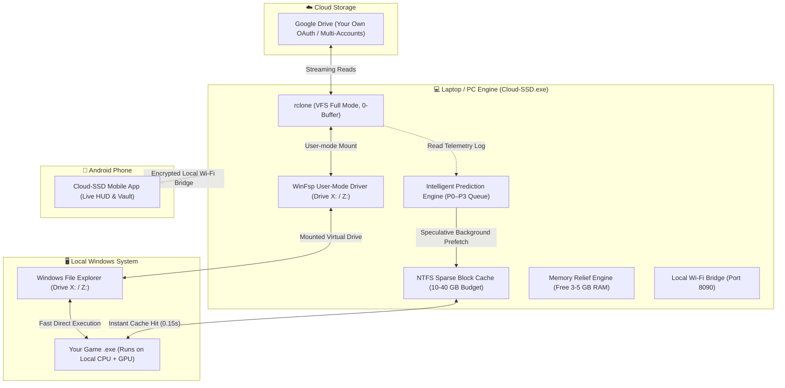
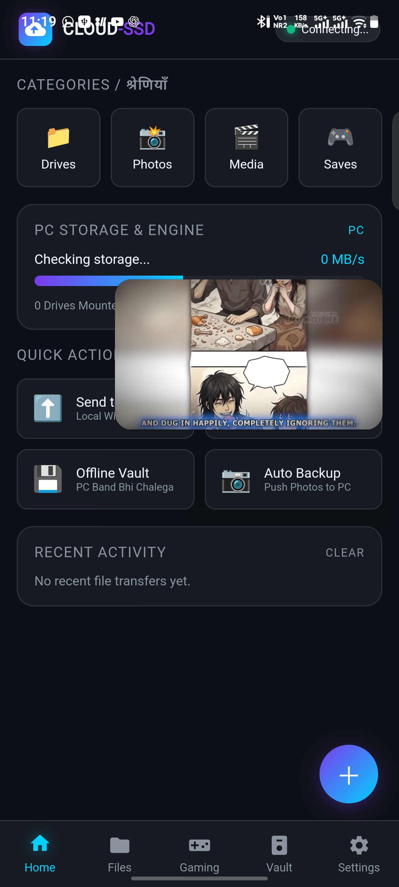
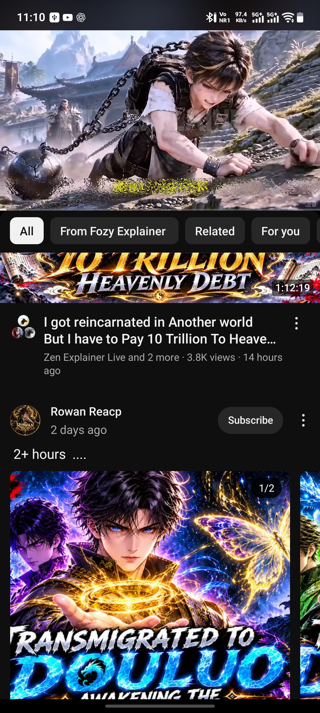
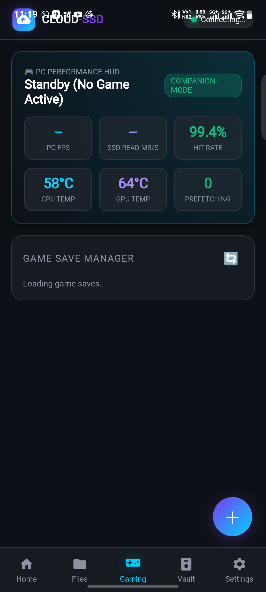
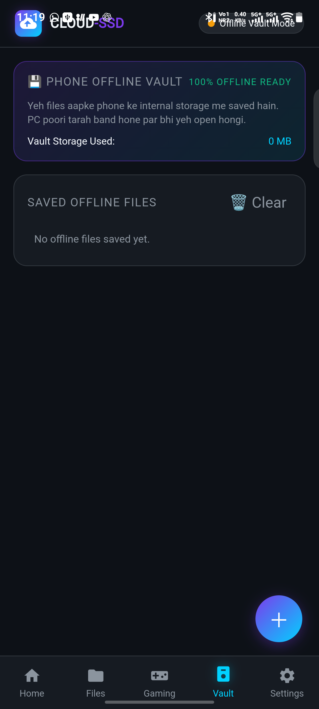

# 🚀 Cloud-SSD

<div align="center">

[](https://github.com/allproject121/Cloud-SSD)
[](https://github.com/allproject121/Cloud-SSD)
[](https://github.com/allproject121/Cloud-SSD)
[](https://winfsp.dev/)
[](https://github.com/allproject121/Cloud-SSD/releases)
[](LICENSE)

**High-Speed Cloud-to-SSD Virtual Storage, 5TB Multi-Drive Pooling & Intelligent Game Streaming Engine.**  
*Apne PC Games aur heavy files ko Cloud Storage (Google Drive) mein rakho, bina laptop hard disk bhare native local drive (`X:` / `Z:`) se access karo, aur phone companion se live monitor karo.*

[Direct Downloads](#-direct-downloads) • [Laptop Guide](#-part-1-laptop--pc-edition-windows-desktop-app) • [Phone Guide](#-part-2-phone--android-edition-mobile-companion-apk) • [How It Works](#-how-it-works-kaise-kaam-karta-hai) • [Benchmarks](#-real-world-benchmarks)

---

</div>

## 📥 Direct Downloads

| Platform | Download Link | Version | File Size | Description |
|---|---|---|---|---|
| 💻 **Windows (Laptop / PC)** | [**Download Windows Setup (EXE)**](releases/Cloud-SSD-0.7.0-setup.exe) | v0.7.0 | `~69.0 MB` | Complete Windows 10/11 x64 Installer with Desktop UI, WinFsp & CLI |
| 📱 **Android (Phone)** | [**Download Android Companion (APK)**](releases/Cloud-SSD-Mobile.apk) | v1.0.0 | `~1.2 MB` | Mobile Gaming HUD, Remote Launcher, Storage Explorer & Offline Vault |
| 🔒 **Checksum** | [View SHA256 Checksum](releases/Cloud-SSD-0.7.0-setup.exe.sha256) | v0.7.0 | `93 B` | Cryptographic integrity verification for Windows Setup |

---

## ⚡ What is Cloud-SSD? (Yeh Kya Hai?)

**Cloud-SSD** koi cloud gaming video stream service (jaise GeForce Now ya Xbox Cloud) **nahi** hai. Yahan games aur applications aapke hi PC/Laptop ke CPU aur GPU par run hote hain.

Lekin aapko 100 GB ke game ko download karke poori laptop SSD bharne ki zarurat nahi hoti! 

Cloud-SSD aapke Cloud Storage (Google Drive) ko Windows File Explorer mein ek **Real Native Virtual Drive (`X:` ya `Z:`)** bana kar mount karta hai. Game sirf wahi block/chunk download karta hai jo us time par play karne ke liye zaroori hota hai, aur AI Prediction Engine next required data ko background mein local SSD par prefetch kar leta hai.

---

## 💻 Part 1: Laptop & PC Edition (Windows Desktop App)

Windows laptop aur desktop ke liye Cloud-SSD ek powerful high-performance storage solution hai:

### 1. 💽 Native Virtual Drive Mount (`X:` / `Z:`)
* Mounts as a fixed drive partition (`DRIVE_FIXED`) in My PC (Windows File Explorer).
* Windows, game launchers (Steam, Epic, standalone), aur installers ko lagta hai ki yeh ek normal physical hard disk hai.
* Zero custom kernel drivers — built on proven user-mode WinFsp 2025 and rclone engine.

### 2. 🗄️ 5TB–15TB Multi-Account Drive Pooling (Union System)
* Multiple Google Drive accounts (e.g. 5–6 accounts = 5TB storage) ko ek single `Z:\` drive letter mein merge karein.
* Jab aap `Z:\` par koi file save karte hain, system automatically sabse zyada free space wale account par store karta hai.
* Standalone batch/PowerShell manager bhi included hai (`tools/5tb-scripts/`).

### 3. 🛡️ Laptop SSD Protection & Zero Bloat (Smart Cache Guard)
* **Custom Cache Budget:** 10 GB, 20 GB, 30 GB, ya 40 GB limit set karein.
* **Disk Reserve Safety:** Main C: drive par hamesha 10 GB free space reserve rakhta hai.
* **NTFS Sparse Caching:** 50 GB ki file me se agar game sirf 50 MB read karega, toh local disk par sirf 50 MB physical space use hogi!
* Aapke laptop ki internal SSD kabhi full nahi hogi aur crash risk zero rahega.

### 4. 🚀 Memory Relief Engine & Virtual RAM Optimization
* 8 GB aur 16 GB RAM wale laptops ke liye special memory trimmer.
* Background me idle pade programs (browsers, background apps) ko physical RAM se safely disk working set me shift karke **3–5 GB physical RAM turant free** karta hai.
* Active game ya software ko maximum memory allocation milti hai bina stuttering ke.

### 5. ⚡ 3 Game Launch Modes
1. **Cloud Direct Mode (Pure Virtual):** Game direct `X:` drive se chalta hai. Zero upfront storage.
2. **Hybrid Optimized Mode (Recommended):** Core startup binaries (`.exe`, `.dll`) local SSD par cache hoti hain aur bhari data files (`.pak`, `.assets`) virtual drive se stream hoti hain.
3. **Full Local Mode (Fallback):** 1 click me poora game background me local SSD par copy ho jaata hai.

---

## 📱 Part 2: Phone & Android Edition (Mobile Companion APK)

Apne Android smartphone ko apne PC ke sath connect karein `Cloud-SSD-Mobile.apk` ke zariye:

### 1. 📊 Live PC Performance & Gaming HUD
* PC par chal rahe game ke live FPS, CPU usage, GPU temperature, aur RAM consumption ko mobile screen par monitor karein.
* Real-time download throughput aur Cloud-to-SSD cache hit rate sparkline graphs.

### 2. 🎮 Remote Game Launcher
* Bed ya sofa par baithe-baithe apne phone se PC par installed kisi bhi game ko 1-tap me launch karein.
* PC ke mounts ko phone se safely connect/disconnect karein.

### 3. 🔒 100% Offline Save Game Vault
* Apne game saves aur important files ko phone ke internal IndexedDB storage me backup karein.
* Agar laptop shut down ho ya internet na ho, tab bhi phone me documents aur saves open rehte hain!

### 4. 📁 Cloud Storage & PC Explorer on Phone
* Phone se PC ke mounted cloud drives (`Z:`, `X:`, `G:`) ko browse karein.
* Files download karein, view karein, aur manage karein.

### 5. 🎬 4K High-Speed Media Streaming
* HTTP 206 Partial Content range requests ke sath 4K video aur high-res audio bina buffering phone par stream hoti hai.

### 📱 Phone Setup Kaise Karein:
1. [**`releases/Cloud-SSD-Mobile.apk`**](releases/Cloud-SSD-Mobile.apk) ko apne Android phone par download aur install karein.
2. Make sure phone aur laptop same Wi-Fi network se connected hon.
3. Laptop app me **Mobile Hub** tab kholein — wahan ek QR code aur IP address dikhega (e.g. `http://192.168.1.5:8090`).
4. Phone app se QR code scan karein ya IP enter karein.
5. **Instant Pairing Done!** Zero external internet ya cloud server needed — 100% private local connection.

---

## 🔄 How It Works? (Kaise Kaam Karta Hai?)



---

## 📊 Real-World Benchmarks

*Hardware: Intel Core i3-10105F, AMD RX 580, 16 GB RAM, Windows 11 Pro, 70 Mbps Cloud Link:*

| Mode / Condition | Load Time | Data Transferred | Cache Verdict | User Experience |
|---|---|---|---|---|
| 💾 **Local NVMe SSD (Baseline)** | `0.09 – 0.12 s` | `54.5 MiB` | 100% Local Read | Ultra Fast |
| 🌐 **Standard rclone mount (Unoptimized, cold)** | `56.5 – 65.2 s` | `498 – 551 MiB` | Bandwidth Waste | Stuttering / Slow |
| 🚀 **Cloud-SSD (Cold, no profile)** | `20.3 – 21.0 s` | `117 – 120 MiB` | 75% Data Reduction | Playable |
| ⚡ **Cloud-SSD (Profiled + Prepared)** | `7.7 – 8.2 s` | Pre-cached Efficiently | SSD-like Responsiveness | Smooth |
| 🔥 **Cloud-SSD (Warm / Fully Cached)** | `0.15 – 0.27 s` | `0 bytes (from SSD)` | Identical to Local SSD | Instant Launch |

---

## 📸 Screenshots & UI Showcase

<div align="center">

| Laptop App Dashboard | Mobile App HUD |
|:---:|:---:|
|  |  |

| Gaming & Telemetry | Offline Vault & Files |
|:---:|:---:|
|  |  |

</div>

---

## 🛠️ Step-by-Step Setup Guide

### 1. Requirements
* **Operating System:** Windows 10 (1809+) or Windows 11 x64.
* **Filesystem:** NTFS drive (for NTFS sparse block caching).
* **Dependency:** [WinFsp 2025+](https://winfsp.dev/rel/) (Bundled in the Setup EXE).

### 2. Quick Install on Laptop
1. Download [**`releases/Cloud-SSD-0.7.0-setup.exe`**](releases/Cloud-SSD-0.7.0-setup.exe).
2. Run the installer and finish installation.
3. Open **Cloud-SSD** from your Desktop shortcut or Start Menu.
4. Go to **Cloud Drives** tab -> Click **Connect Drive** -> Sign in to your Google Account.
5. Select a drive letter (e.g. `X:` or `Z:`) and click **Mount**. Drive opens in File Explorer!

### 3. Connect Android Phone
1. Install [**`releases/Cloud-SSD-Mobile.apk`**](releases/Cloud-SSD-Mobile.apk) on your Android phone.
2. In the PC app, click on **Mobile Hub** tab.
3. Scan the QR code with your phone camera or app.
4. Access live HUD, PC controls, and offline vault!

---

## 🧑‍💻 Technical Specifications (For Developers)

```
Solution: CloudSSD.slnx (.NET 10 x64)
Language: C# (Latest, Nullable enabled)
Architecture: Clean Architecture + MVVM (CommunityToolkit.Mvvm)
Subprojects:
  ├── CloudSSD.Core          -> Atomic JSON settings, paths, units, Win32 P/Invoke
  ├── CloudSSD.Mount         -> rclone supervisor, WinFsp mounting, log tailer
  ├── CloudSSD.Cache         -> Sparse file accounting, disk safety, eviction
  ├── CloudSSD.Streaming     -> Predictors, prefetch scheduler, network governor
  ├── CloudSSD.Games         -> PE analyzer, compatibility, launcher, hybrid builder
  ├── CloudSSD.Desktop       -> WPF modern UI, sparklines, dialogs
  ├── CloudSSD.Diagnostics   -> DPAPI secret store, redactor, diagnostic zip
  ├── CloudSSD.Providers     -> Cloud provider descriptors (Google Drive, etc.)
  ├── CloudSSD.Cli           -> Headless cpx.exe command line tool
  ├── CloudSSD.SimCloud      -> Throttled mock cloud server for testing
  ├── mobile-android           -> Native Android companion client (WebView/PWA Bridge)
  └── tools/5tb-scripts        -> Standalone 5TB multi-account union mount scripts
```

---

## 📖 Documentation Reference

* 📜 **Master Project Index & Architecture:** [`CODEX.md`](CODEX.md)
* 🛠️ **Antigravity Action Log & Fixes:** [`ANTIGRAVITY.md`](ANTIGRAVITY.md)
* 📐 **Detailed Engine Architecture:** [`ARCHITECTURE.md`](ARCHITECTURE.md)
* 📊 **Comprehensive Benchmarks:** [`BENCHMARKS.md`](BENCHMARKS.md)
* 🧠 **RAM & Virtual Memory Architecture:** [`RAM.md`](RAM.md)
* ⚠️ **Known Limitations & Edge Cases:** [`KNOWN_LIMITATIONS.md`](KNOWN_LIMITATIONS.md)
* 💽 **5TB Disk System Guide:** [`tools/5tb-scripts/5TB_DISK_README.md`](tools/5tb-scripts/5TB_DISK_README.md)

---

<div align="center">

Made with ❤️ by Cloud-SSD Contributors.  
Licensed under the [MIT License](LICENSE).

</div>
